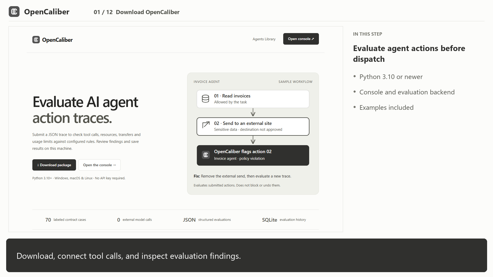

# OpenCaliber

Advisory risk evaluation of AI agent actions, with a local dashboard, findings, configurable rules, evidence export and 70 labeled regression scenarios. The evaluation engine and desktop console require no external inference, subscriptions or API keys and use the Python 3.10+ standard library. Optional live agent starters require provider credentials and may incur charges; hosted deployment uses the dependencies in requirements.txt.

## Watch the walkthrough

[](https://opencaliber.net/#walkthrough)

**[Watch the captioned video](https://opencaliber.net/#walkthrough)** · [Open the MP4 directly](https://github.com/arun1011/opencaliber/raw/refs/heads/main/web/media/opencaliber-walkthrough.mp4)

A five-and-a-half-minute demonstration of setup, agent integrations, findings, configuration and regression checks. Includes male narration at a moderate instructional pace and English captions.

## Start

For a fresh Git clone, first generate the downloadable agent packs (Python standard library only):

```sh
python tools/build_agent_library.py
```


Clone or download this repository. On Windows double-click `start-windows.cmd`, or run:

```powershell
python run.py
```

On macOS/Linux: `sh start-macos-linux.sh` or `python3 run.py`.

Open http://127.0.0.1:8787/console . The home page is http://127.0.0.1:8787/ . Stop with Ctrl+C. If port 8787 is in use, run `python -m opencaliber.agent_server --port 8788` and open the corresponding URL.

## Integrate with an agent

Normalize tool events to the schema in `examples/agent_trace.json`. The engine is model-neutral: it can evaluate Gemini, Claude or any other agent's supplied events, but does not automatically discover or intercept them.

### Python, no server required

From the repository directory:

```powershell
python examples/integrate_agent.py
```

For another Python project, add the extracted directory to its PYTHONPATH, then:

```python
from opencaliber import evaluate_trace
result = evaluate_trace(trace)
if result['assessment'] != 'clear':
    # Route to your review workflow; do not execute here.
    pass
```

`evaluate_trace(trace, config)` accepts an optional complete configuration dictionary. Import `DEFAULT_CONFIG` from `opencaliber.agent_engine` as a starting point. Direct Python evaluation does not save a dashboard record; use the HTTP API for persistence.

### HTTP, any language

Start the server, then POST JSON `{ "trace": ... }` to `/api/evaluate` with `Content-Type: application/json`. The response includes an evaluation ID and structured results; the dashboard updates when refreshed.

```python
import json, urllib.request
request = urllib.request.Request(
    'http://127.0.0.1:8787/api/evaluate',
    data=json.dumps({'trace': trace}).encode(),
    headers={'Content-Type':'application/json'})
result = json.load(urllib.request.urlopen(request))
```

### CLI and tests

```powershell
python -m opencaliber.agent_cli evaluate --input examples/agent_trace.json
python -m opencaliber.agent_cli benchmark --output report.json
python -m unittest discover -s tests -v
```

## Review model and limitations

`violation`: an explicit declared task or policy rule triggered. `review`: uncertainty or a review signal. `clear`: no implemented rule triggered, never a guarantee of safety. Scores are heuristic severities, not calibrated probabilities. The current engine does not semantically infer arbitrary goals and has no trained LLM connection.

Scope, approval and sensitivity labels are caller-supplied and unauthenticated. There is no tool execution, network firewall, DNS resolution, sandbox, live-agent connector or automatic containment. Resource budgets cover one trace only. Shell inspection uses incomplete patterns. Normalize paths to absolute POSIX paths. Untrusted text checks do not establish prompt injection or causality.

The 70 synthetic cases test implemented rules, not independent security effectiveness. The suite uses active configuration plus fixture-specific overrides; inspect mismatches after changing policies.

History and configuration are stored in `artifacts/agent-console.sqlite3` under the extracted folder. The server binds only to loopback, checks host/origin, and serves the `web/` directory. It has no multi-user authentication or at-rest encryption. Do not expose it to a network. Redact sensitive traces and protect the local files.

The downloadable ZIP is assembled from a fixed source allowlist and excludes your database, private traces, model weights and credentials. It does not include the separate model-training research. OpenCaliber original software is licensed under Apache-2.0. See [LICENSE](LICENSE), [NOTICE](NOTICE), and [licensing scope](LICENSING.md). Every downloadable runtime and agent pack includes these files.

## Project and contribution

OpenCaliber is an independent personal open-source project, not affiliated with or endorsed by the maintainer's employer. See CONTRIBUTING.md and SECURITY.md.

The current release is a deterministic evaluation toolkit. It does not include a trained anomaly model or the separate experimental training work.

## Walkthrough

The home page includes a captioned walkthrough. Media and branding reuse have separate considerations described in LICENSING.md.

## Elastic Beanstalk deployment

Hosted entry point: `application:application`, launched by the root `Procfile`. Build `dist/opencaliber-elasticbeanstalk.zip` with `python deploy/build_bundle.py` and validate it with `python tools/check_deployment.py`. See [deployment instructions](docs/elastic-beanstalk.md). No AWS resources are created by building or checking. The model-training experiments are excluded from this repository.

## Build downloadable packages

```sh
python tools/build_agent_library.py
python -m opencaliber.local_package
python deploy/build_bundle.py
python tools/check_deployment.py
```

Agent packs are generated in web/downloads/agents. The console package is generated in artifacts, and the Elastic Beanstalk bundle in dist. Attach generated ZIPs to GitHub Releases.

## Development checks

```sh
python -m pip install -r requirements-dev.txt
python -m unittest discover -s tests -v
node tests/test_node_sdk.mjs
```

These checks use synthetic fixtures and mock provider calls; they do not establish real-world security effectiveness.

## Public website on GitHub Pages

The included Pages workflow publishes the static website and downloads. Select **GitHub Actions** in Settings → Pages, then push to main. See [GitHub Pages setup](docs/github-pages.md). The Python evaluation console remains a downloadable application.
