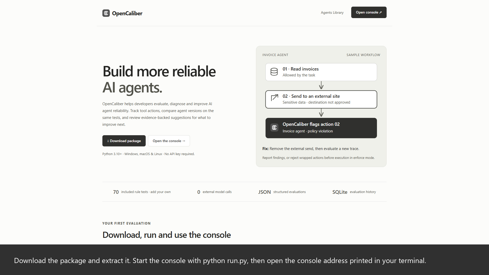

# OpenCaliber

**OpenCaliber helps developers evaluate, diagnose and improve AI agent reliability.**

Track instrumented tool actions, evaluate configured boundaries, and compare agent versions against the same paired tests. Inspect application-reported task success, policy violations, cost and latency, then review proposed tests and improvements. The engine and desktop console use Python 3.10+ standard library; optional live agents and hosted deployment have their documented requirements.

## Observe without tool wrappers

Start the console with `python run.py`, then change the Python agent startup command:

```sh
python -m opencaliber.connect --agent-id my-agent --version v1 -- my_agent.py
```

The launcher captures default SQLite and urllib calls, plus synchronous Requests/HTTPX
when installed. It sends metadata for console policy evaluation after execution.
No tool-function edits are required; restore the original command to remove it.
It does not block operations, infer business success or monitor all libraries.
See [coverage, privacy and fleet setup](docs/python-launcher.md).


## Check tool steps and recovery

The wrapper retains emitted calls, including rejections and retries. Explicit tool contracts can check typed arguments/outputs, earlier returned identifiers and state requirements. Task success, policy compliance and tool-step validity remain separate. Missing evidence stays unknown. Run `python examples/step_checks/agent.py` and see [Tool step checks](docs/step-reliability.md).

## Compare versions and propose improvements

Use **Compare agent versions**. Run the application-owned callbacks on identical case inputs with `opencaliber.comparison.run_versions`, then import the generated bundle. Both versions use one fixed policy snapshot. The console saves a comparison report with success rates, policy violations, contract matches, reported cost, callback latency and failure examples. Missing measurements stay unknown.

```sh
python examples/version_comparison/run.py
```

The included demo is illustrative: it uses synthetic in-memory agents and simulated tool metadata, with no external tool or provider calls. Replace the callbacks with your actual agents and application-owned outcome assertions. See [Version comparison](docs/version-comparison.md).

**Adaptive initially means proposing which tests and improvements to review.** Proposals are deterministic and evidence-driven; they never silently rewrite policies, prompts or code, or modify deployed agents. A single paired run is exploratory evidence, not an independent benchmark or a causal claim. Developer review and repeated held-out testing remain necessary.

## Automatic monitoring

Start the console, then run a library agent or add `TrackedExecutor` wrappers to your own Python tool operations. Agents register a tracking ID and send action metadata to your console. Use **Monitored agents**, **Configure agent checks**, **Activity** and **Problems** for everyday work. New agents start in report-only mode; enforcement is an explicit per-agent setting. Direct `evaluate_trace` calls remain offline and do not automatically save dashboard history.

See [Automatic tracking and internal-domain setup](docs/automatic-tracking.md). GitHub Pages hosts the public website and packages; deploy the authenticated Python service for a shared internal console.

## Contract cases and download counts

Use Developer tools → Add contract cases to preview and save workspace regression tests. Test rule examples runs them alongside the included fixtures. [Tracking guide](docs/automatic-tracking.md) explains expected results, overrides and storage.

Public package downloads can use GitHub Release assets. The publish workflow switches Pages links only after every package is uploaded. Hourly counts are retained in a versioned JSON file on the separate download-metrics branch, so site deployments do not reset recorded history. [Download-count setup](docs/download-counts.md) explains activation and what the counts measure. Earlier static Pages downloads remain unknown.

## Watch the walkthrough

[](https://github.com/arun1011/opencaliber/blob/main/web/media/opencaliber-walkthrough.mp4)

A walkthrough of the current console: connect an agent, set rules, inspect problems and configure an internal HTTPS workspace, with male narration and English captions.

## Start

For a fresh Git clone, first generate the downloadable agent packs (Python standard library only):

```sh
python tools/build_agent_library.py
```


Clone or download this repository. On Windows double-click `start-windows.cmd`, or run:

```powershell
python run.py
```

On macOS/Linux: `sh start-macos-linux.sh` or `python3 run.py`.

Open http://127.0.0.1:8787/console . The home page is http://127.0.0.1:8787/ . Stop with Ctrl+C. If port 8787 is in use, run `python -m opencaliber.agent_server --port 8788` and open the corresponding URL.

## Integrate with an agent

Normalize tool events to the schema in `examples/agent_trace.json`. The engine is model-neutral: it can evaluate Gemini, Claude or any other agent's supplied events, but does not automatically discover or intercept them.

### Python, no server required

From the repository directory:

```powershell
python examples/integrate_agent.py
```

For another Python project, add the extracted directory to its PYTHONPATH, then:

```python
from opencaliber import evaluate_trace
result = evaluate_trace(trace)
if result['assessment'] != 'clear':
    # Route to your review workflow; do not execute here.
    pass
```

`evaluate_trace(trace, config)` accepts an optional complete configuration dictionary. Import `DEFAULT_CONFIG` from `opencaliber.agent_engine` as a starting point. Direct Python evaluation does not save a dashboard record; use the HTTP API for persistence.

### HTTP, any language

Start the server, then POST JSON `{ "trace": ... }` to `/api/evaluate` with `Content-Type: application/json`. The response includes an evaluation ID and structured results; the dashboard updates when refreshed.

```python
import json, urllib.request
request = urllib.request.Request(
    'http://127.0.0.1:8787/api/evaluate',
    data=json.dumps({'trace': trace}).encode(),
    headers={'Content-Type':'application/json'})
result = json.load(urllib.request.urlopen(request))
```

### CLI and tests

```powershell
python -m opencaliber.agent_cli evaluate --input examples/agent_trace.json
python -m opencaliber.agent_cli benchmark --output report.json
python -m unittest discover -s tests -v
```

## Review model and limitations

`violation`: an explicit declared task or policy rule triggered. `review`: uncertainty or a review signal. `clear`: no implemented rule triggered, never a guarantee of safety. Scores are heuristic severities, not calibrated probabilities. The current engine does not semantically infer arbitrary goals and has no trained LLM connection.

Scope, approval and sensitivity labels are caller-supplied and unauthenticated. The evaluator does not execute tools. The optional Python GuardedExecutor can reject callbacks before dispatch in enforce mode. No network firewall, DNS resolution, sandbox or automatic live-agent connector is included. Resource budgets cover one trace only. Shell inspection uses incomplete patterns. Normalize paths to absolute POSIX paths. Untrusted text checks do not establish prompt injection or causality.

The 70 synthetic cases test implemented rules, not independent security effectiveness. The suite uses active configuration plus fixture-specific overrides; inspect mismatches after changing policies.

History and configuration are stored in `artifacts/agent-console.sqlite3` under the extracted folder. The server binds only to loopback, checks host/origin, and serves the `web/` directory. It has no multi-user authentication or at-rest encryption. Do not expose it to a network. Redact sensitive traces and protect the local files.

The downloadable ZIP is assembled from a fixed source allowlist and excludes your database, private traces, model weights and credentials. OpenCaliber original software is licensed under Apache-2.0. See [LICENSE](LICENSE), [NOTICE](NOTICE), and [licensing scope](LICENSING.md). Every downloadable runtime and agent pack includes these files.

## Project and contribution

OpenCaliber is an independent personal open-source project. See [contribution guidance](CONTRIBUTING.md) and [security reporting](SECURITY.md).

The current release is a deterministic evaluation toolkit; it does not include a trained anomaly model.

## Walkthrough

The home page includes a captioned walkthrough. Media and branding reuse have separate considerations described in LICENSING.md.

## Developer documentation

- [Integrating agents and provider tool calls](ADOPTION.md)
- [Configuring and running evaluations](LOCAL_TOOL.md)
- [Deployment instructions](docs/elastic-beanstalk.md)
- [Contributing and testing changes](CONTRIBUTING.md)

## Sequence-dependent checks

Engine 0.4 supports opt-in rules such as backup-before-delete for the same resource. Configure them in the console, supply application-recorded execution outcomes, and inspect matched or missing prerequisite evidence. [Configuration, runnable examples and trust limits](docs/sequence-rules.md).

## Adoption utilities

Use policy profiles, the application execution wrapper, offline MCP and Databricks audit imports, coverage reports and CI evaluations. Start at [enterprise integration building blocks](docs/enterprise-adoption.md) and the Developer Guide in the console. These utilities do not add cloud authorization or datasource inspection.

## Per-tool resource and argument policies

Engine 0.5 adds exact-value allowlists, POSIX directory boundaries, exact URL hostnames and inclusive numeric limits per canonical tool. Rules narrow existing global/task restrictions. Configure them in Console Configuration or import [the example config](examples/tool-policy-config.json). See [policy semantics, integration and execution limits](docs/tool-policies.md). Custom flat scalar arguments are supported by Python and Node projections and removed from redacted history.

## Browser and document workflow packs

The Agents Library includes Browser Research Assistant, Report Collection Agent, Application Test Agent and Document Workflow Agent. Each ZIP provides a credential-free offline demo, reviewed configuration, source and tests. Browser live mode requires Playwright and explicit configuration approval; portal sign-in is manual. These are bounded code-driven workflows, not general desktop-control or autonomous LLM agents. See the included README before live use.

## Database search and summarization example

See [examples/database_summary](examples/database_summary/README.md) for a runnable SQLite-to-mock-LLM workflow with OpenCaliber checks before each callback, policy JSON, five scenarios and tests. It demonstrates blocked transfers and operational failures without credentials or network calls.

### Multi-agent execution graphs

Record agents, tools, retries, handoffs and dependencies under one trajectory ID. Review repeated work, circular delegation, missing evidence and explicitly attributed error propagation in **Execution graphs**. Run `python examples/multi_agent/run.py` for a working example. See [multi-agent integration](docs/trajectories.md) for instrumentation, semantics and limits. Graphs reconstruct reported spans; they do not discover uninstrumented activity.

### Context-aware failure diagnosis

Use **Agents Dashboard → Diagnose run** to review captured objectives, ordered actions and selected outputs against the recorded policy. Enable diagnosis and a safe output extractor once in the wrapper; no manual evidence upload is needed. Policy checks, optional local semantic review and separately supplied verification are reported independently. Try `python examples/context_diagnosis/run.py`; see [diagnosis integration](docs/context-diagnosis.md) for local model setup and application-owned verification callbacks. Model findings remain advisory and do not change execution permissions.

### Develop a missing check

In Detection capabilities, select a gap to open the check wizard: define, develop, test, enable. An optional OpenAI, Claude, Gemini or downloaded Hugging Face coding model can draft the restricted Python check. Enabled revisions apply to new online events; missing evidence stays visible until supplied. See [Custom detection checks](docs/custom-checks.md) for examples, model setup and limitations.

See [Console guide](docs/console-guide.md) for the seven sidebar workflows, examples and current screenshots.

### Library monitoring and version tests

All library packs include configurable versions, explicit outcome checks, bounded output summaries and tool execution graphs. Use `compare_versions.py --candidate ../candidate-folder` with your console running to compare two isolated fixture versions. See [Library integration](docs/library-integration.md) for evidence capture, actual input fingerprints and domain-specific success assertions.

## Releases

The Releases page lists versioned downloads and short change notes. [Release maintenance](docs/releases.md) explains how to create a new immutable package when core functionality changes. Check the installed platform version in VERSION; engine and individual agent versions are separate identifiers.

## Creator & Research Lead

**[Arun Kumar](https://www.linkedin.com/in/arunkumar1011/)**\
*Causal Inference & AI Research*

I created OpenCaliber as an open-source project to learn and collaborate with developers on evaluating AI agent actions and inspecting policy findings. [Connect on LinkedIn](https://www.linkedin.com/in/arunkumar1011/) to discuss the project and collaboration.
