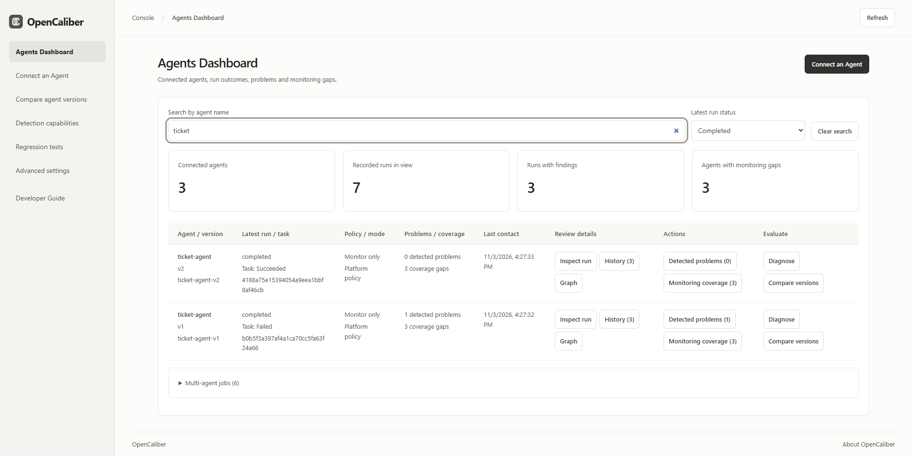
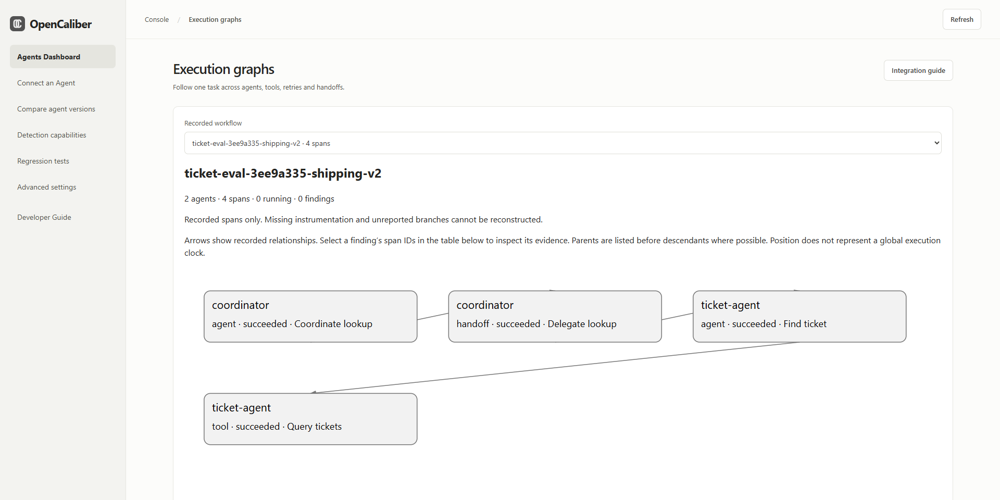
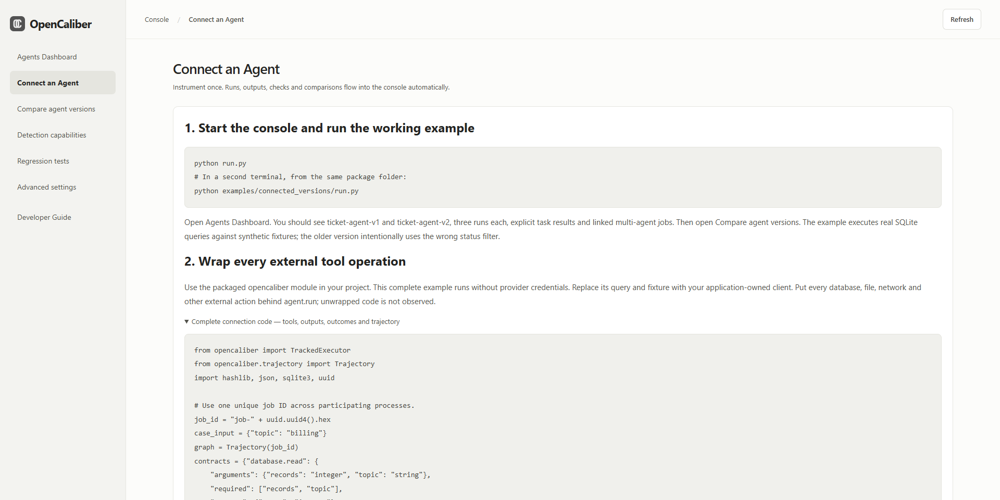
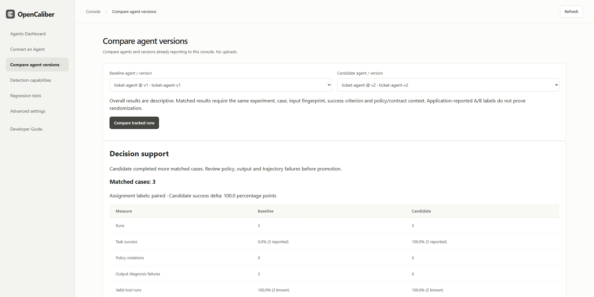
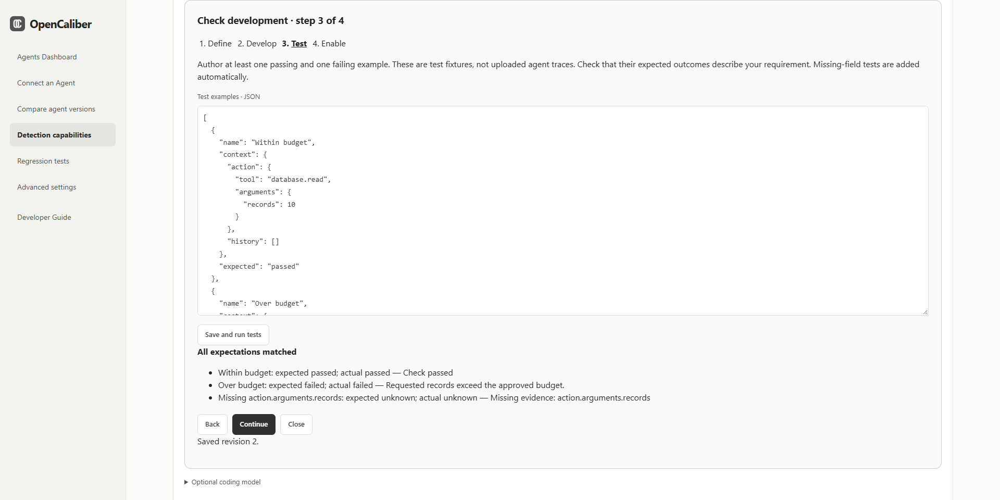
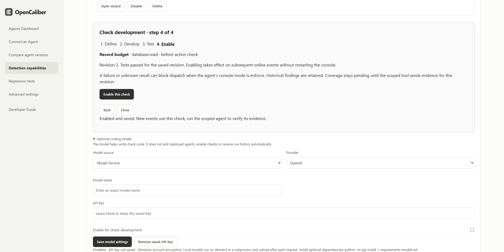
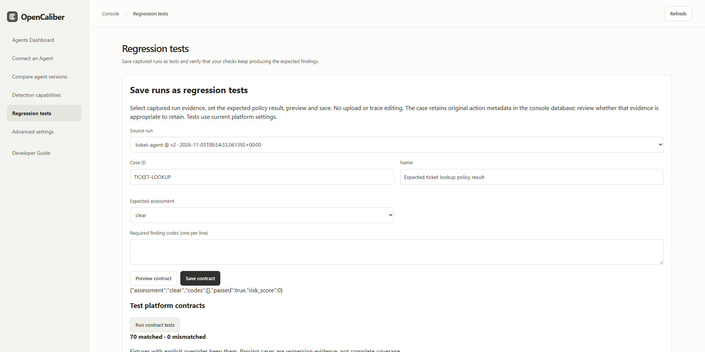
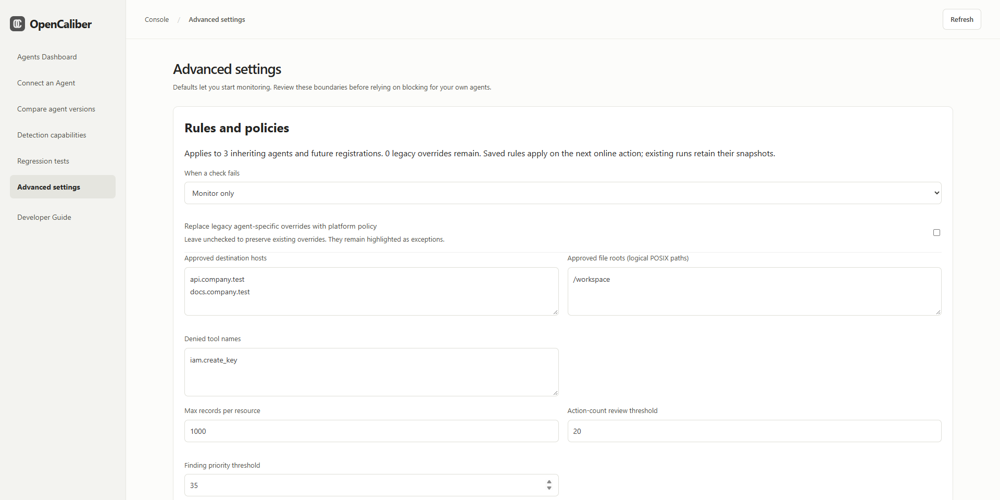
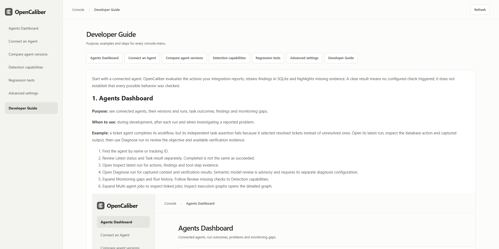

# OpenCaliber console guide

Start with a connected agent. OpenCaliber evaluates the actions your integration reports, retains findings in SQLite and highlights missing evidence. A clear result means no configured check triggered; it does not establish that every possible behavior was checked.

## 1. Agents Dashboard

**Purpose:** see connected agents, their versions and runs, task outcomes, findings and monitoring gaps.

**When to use:** during development, after each run and when investigating a reported problem.

**Example:** a ticket agent completes its workflow, but its independent task assertion fails because it selected resolved tickets instead of unresolved ones. Open its latest run, inspect the database action and captured output, then use Diagnose run to review the objective and available verification evidence.

1. Find the agent by name or tracking ID. Filter by Latest run status to show completed, failed/evaluation-error, blocked, in-progress or waiting agents. This filter uses each agent’s latest run; task success is reported separately. Each agent has one table row with its version, latest status, task result, policy mode, findings, gaps and last contact. Review details groups inspection, history and the execution graph; Actions groups Detected problems and Monitoring coverage with counts; Evaluate groups Diagnose and Compare versions.
2. Review Latest status and Task result separately. Completed is not the same as succeeded.
3. Use Inspect in the agent row for actions, findings and tool-step evidence.
4. Use Diagnose in the same row for captured context and verification results. Semantic model review is advisory and requires its separate diagnosis configuration.
5. Select Detected problems, History or Monitoring coverage in the row to expand the corresponding details. Follow Review missing checks to Detection capabilities.
6. Select Graph in a linked agent row to inspect its job summary, or Compare to open version comparison. Multi-agent jobs below the table lists all linked jobs.



Graphs are created from explicitly reported agent/tool/handoff spans and parent, dependency and retry links. They cannot discover unreported work. Graph-only participants are listed separately from registered executors. Circular delegation and repeated work are review signals; application intent can make them legitimate.



The dashboard shows all registered agents and the latest 1,000 saved records. SQLite history survives a restart. Back up the database while the console is stopped. New downloaded packages contain no existing runtime database.

## 2. Connect an Agent

**Purpose:** add the wrapper, tracking identity, output capture and execution links to your application.

**When to use:** when adopting OpenCaliber, adding a tool or instrumenting another worker in a multi-agent job.

**Example:** query a database and summarize the selected records. Put both the database callback and the LLM callback behind `agent.run`. OpenCaliber checks the declared action before dispatch when enforcement is active and receives the outcome afterward. It does not automatically observe SDK calls outside the wrapper.

1. Start the console with `python run.py` from the downloaded package. In a source checkout use `python -m opencaliber.agent_server`.
2. In another terminal run `python examples/connected_versions/run.py` to create two tracked example versions.
3. Copy the complete connection example into your project and replace its synthetic query with your own callback.
4. Give each agent a tracking ID and explicit version. Distinct version IDs or a stable agent ID with explicit versions can identify comparison cohorts; never reuse a tracking ID for a different agent ID.
5. Declare authorized tools/resources and per-tool argument/output contracts.
6. Capture selected safe outputs and independently evaluate task success.
7. Run allowed, denied and failure paths, then inspect the dashboard and gaps.



```python
from opencaliber import TrackedExecutor

with TrackedExecutor(
    agent={"id": "ticket-reader", "version": "2.0"},
    tracking_id="ticket-reader",
    task={"goal": "Read unresolved login tickets",
          "allowed_tools": ["database.read"],
          "allowed_resources": ["tickets"]},
    tool_contracts={"database.read": {
        "arguments": {"records": "integer", "match_mode": "string"},
        "required": ["records", "match_mode"]}},
    contract_mode="enforce",
    diagnosis=True,
    capture_output=lambda action, rows: {"ids": [row[0] for row in rows]},
) as agent:
    rows = agent.run(
        {"id": "lookup", "tool": "database.read", "resource": "tickets",
         "arguments": {"records": 10, "match_mode": "exact"}},
        query_unresolved_login_tickets,
        success=lambda result: isinstance(result, list),
    )
    agent.record_outcome(check_expected_ticket_ids(rows))
```

`query_unresolved_login_tickets` and `check_expected_ticket_ids` are application-owned functions. Define the expected IDs independently of the agent's answer. Do not send complete private rows merely to populate a dashboard. Diagnosis capture explicitly retains the fields returned by your callback.

For multiple workers, propagate one `trajectory_id`, parent span IDs and explicit dependencies through job messages. Each worker wraps its own tools. Sequence gates within one executor do not share state across machines; coordinate destructive dependent actions through one executor or a separately reviewed shared gate.

For an internal HTTPS deployment, configure `OPENCALIBER_ENDPOINT` and `OPENCALIBER_TOKEN` on the agent. The hosted console requires its configured origin, authentication and persistent data storage. GitHub Pages serves setup information and downloads; it cannot run the Python evaluation backend.

## 3. Compare agent versions

**Purpose:** compare two agent/version cohorts already reporting to the console.

**When to use:** after changing a prompt, model, tool implementation, routing logic or workflow.

**Example:** compare a substring ticket search with an exact-match version using identical fixture inputs. Review task success, policy violations, diagnosis failures, tool validity, latency, reported cost and linked trajectory findings.

1. Run both versions and report explicit task outcomes.
2. Select a baseline and a candidate, then Compare tracked runs.
3. Read Matched cases before interpreting overall observed metrics.
4. Inspect failure examples and graph findings before promoting a version.



```python
evaluation={
    "experiment_id": "ticket-search-v1-v2",
    "case_id": "unresolved-login",
    "input_sha256": canonical_input_hash,
    "success_criterion": "exact-expected-ticket-ids",
    "assignment": "paired",
}
```

Pass this metadata to each executor. Both versions need the same experiment, case, actual input fingerprint, success criterion, policy, enabled custom-check specifications, tool contracts and initial state to be matched. Only the latest run per repeated case/cohort is paired. Missing success/cost/latency remains unknown. Workflow latency includes wrapper overhead. A reported cost can be an estimate or provider value; inspect provenance.

The console does not randomize traffic or establish statistical significance. Overall runs may differ in workload; an application-reported randomized label is not independent proof of randomization. A small paired example demonstrates behavior on those cases, not general superiority.

## 4. Detection capabilities

**Purpose:** resolve missing checks, develop a detector and manage optional coding assistance.

**When to use:** the dashboard identifies an unconstrained argument or your task needs a new check beyond existing policy fields.

**Example:** reject a ticket query when `match_mode` is not `exact`.

1. Select Add missing check beside the relevant gap, or Create a detection check.
2. **Define:** name, tool, tracking-ID scope, before/after timing, finding message and recommended fix.
3. **Develop:** write the restricted Python code and declare each evidence path. A model can optionally draft it.
4. **Test:** provide passing and failing synthetic examples, then Save and run tests. Missing-field tests are added automatically.
5. **Enable:** activate the tested saved revision. New online events use it immediately.
6. Run the scoped tool again. Coverage remains awaiting evidence until the new revision evaluates usable evidence.

```python
def check(ctx):
    return field("action.arguments.match_mode") != "exact"
```

Required evidence: `action.arguments.match_mode`. True means a problem, False means passed, and missing/invalid evidence means unknown. Before-action checks can gate dispatch in enforce mode. After-action checks inspect outputs and cannot undo a completed action. Findings on preceding actions may affect a subsequent dispatch.



Supported helpers: `field`, `contains`, `lower`, `count`, `previous_succeeded`; comparisons and boolean expressions are supported. No imports, loops, arbitrary Python functions, shell, network or file access are allowed. More general algorithms require a reviewed backend extension. Editing a saved check disables it and invalidates tests; retest and enable the revised code. Disable/delete affects future events and preserves historical findings and the revision audit.

### Optional coding model

Open Optional coding model on this page. Model Service supports OpenAI, Claude / Anthropic and Google / Gemini. Enter the exact model name and API key, enable and save. Keys stay encrypted server-side and are never returned by the settings API.

Local Model supports public Hugging Face `owner/model` IDs with compatible causal-model Safetensors weights. Install `requirements-models.txt`, enter a model ID, download, then enable and save. Models needing downloaded Python code, GGUF-only models and gated repositories needing a token are unsupported by this manager. Downloaded models can be deleted from the same panel. Inference runs on demand and unloads afterward; model size, architecture and available compute affect whether it succeeds.



In wizard step 2, review the draft and examples, consent to submitting them, then Run coding model to draft code. The assistant cannot enable its draft or edit deployed agents. Run history is not automatically sent. Windows uses account-bound credential encryption. Linux/macOS needs the optional cryptography dependency and a persistent `OPENCALIBER_SECRET_KEY`. See `docs/custom-checks.md` for complete setup and limits.

An evidence gap opens integration instructions instead. A new detector cannot create missing tool outputs, task assertions or graph spans. Unsupported tool semantics also remain a gap when a custom check addresses only one field.

## 5. Regression tests

**Purpose:** save captured connected runs as repeatable policy tests.

**When to use:** after reproducing a violation, fixing a false positive or changing policy/evaluation behavior.

**Example:** save a run that requested more records than allowed. Set expected assessment to violation and include the finding code shown on that run. After changing the record limit or engine, rerun the case to verify its expected behavior.

1. Choose a source run with captured original context.
2. Set a case ID, descriptive name, expected assessment and required finding codes.
3. Preview the case. A mismatch means your expectation or configured checks need review.
4. Save the case, then Run contract tests.
5. Inspect mismatches and rerun after an intentional correction.



These are regression examples, not additional detector implementations or new permissions. They use current platform policy settings; included fixtures with explicit overrides retain them. Custom detector code has its own wizard test suite. A saved-run policy test does not automatically execute that custom detector. A redacted-only run cannot reliably become a new case; enable diagnosis capture and reproduce it. Saved cases retain original action metadata; consider whether that evidence should be kept.

## 6. Advanced settings

**Purpose:** configure shared policy boundaries, mode and supported per-tool/sequence restrictions.

**When to use:** when the defaults do not match your application or before relying on blocking. You can begin observing agent activity with defaults.

**Example:** approve a model-service host, set a maximum record budget and require a successful backup before a destructive operation.

1. Start in Monitor only while reviewing what actions your agent reports.
2. Review approved hosts/file roots, denied tools, limits and declared task scope.
3. Add allowed values, host/path restrictions or numeric bounds for a supported tool field.
4. Review advanced sequence rules where prior successful operations are required.
5. Save and run representative allowed and denied paths before selecting Block violations.



Saved settings apply on subsequent online actions to inheriting agents and future registrations. Existing agent-specific overrides remain until explicitly reset. Local wrapper rules remain independently active. Enabling console monitoring does not automatically override a stricter wrapper. Historical runs retain their recorded policy snapshot.

## 7. Developer Guide

**Purpose:** find the integration patterns, meaning of results, setup steps and troubleshooting instructions in one place.

**When to use:** during onboarding, when adding multi-agent relationships or when a result is unknown or unexpected.

**Example:** a run says output evidence is missing. Consult Detection capabilities and Connect an Agent, add the needed safe output fields, rerun and verify that the affected check now evaluates the enabled revision.



Use the chapter buttons to jump between the seven sidebar workflows. Detailed implementation references are included in `docs/custom-checks.md`, `docs/context-diagnosis.md`, `docs/trajectories.md` and `docs/connected-console.md`.

## Troubleshooting and interpretation

- **Console evaluation unavailable:** in enforcement, the callback was not dispatched. Check that the server is running, endpoint/token/origin are correct and wrapper/backend versions agree. Restart the console after a source update; adding a tested check itself needs no restart.
- **ActionBlocked:** inspect the policy or tool-contract rejection; correct the scope, arguments or prerequisite rather than suppressing the check.
- **ExecutionEvidenceFailed:** the callback ran, but evidence failed or stayed unknown. Reconcile actual state before retrying; partial effects may exist.
- **Workflow failed or callback exception:** examine action outcomes, application logs and external state. The wrapper does not roll back arbitrary tools.
- **Unknown/insufficient evidence:** supply the required information. Unknown is not a pass or an established violation.
- **Check remains missing:** confirm it is enabled for the right tool/tracking ID and a new online run evaluated its current revision. Hidden branches and unwrapped actions remain unobserved.
- **No matched comparison:** align case/input/criteria/policy/check/contract metadata and report an independent task outcome for both versions.
- **Model unavailable:** confirm model access, API quota or local dependencies/memory. Manual check development and deterministic evaluation remain available.

Select original output fields deliberately, keep credentials out of traces/test fixtures and use the authenticated HTTPS service for remote agents. The synchronous wrapper does not sandbox tool callbacks, infer business correctness or cancel arbitrary operations. You own authorization, tool timeouts, idempotency and independent verification.
